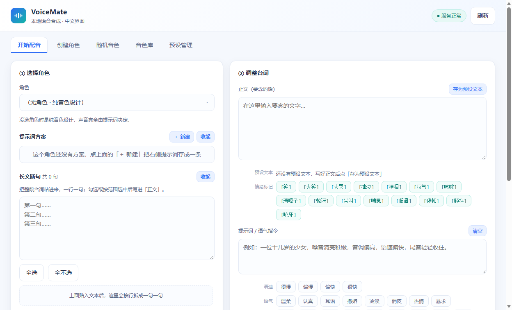

# VoiceMate

**本地中文语音合成工作台**（Windows）——给 [Breeze-TTS-2.cpp](https://github.com/HoppouAI/Breeze-TTS-2.cpp) 套的一层中文界面：
选角色、调语气、边生成边播报、一键存成 wav。



## 功能

- **开始配音**：选角色 → 写正文 → 生成；首包约 0.5 秒，边合成边播放，不用等整段
- **提示词 / 语气指令**：36 个气泡（语速 4、语气 8、情绪 15、状态 9），点一下追加到提示词
- **情绪标记**：15 个中括号标签（`[笑]` `[大哭]` `[叹气]` …），插到正文光标处，只影响朗读
- **长文断句**：整段台词一行一句粘进来，勾选或按范围选中后写进正文
- **预设文本 / 提示词方案**：全局文本库 + 按角色的方案（只存提示词和参数，不存正文）
- **角色**：用 5～15 秒参考音频克隆；音色库可改描述、删除
- **随机音色**：不挂参考音频，纯提示词设计声音
- **保存**：按「角色名_正文前 8 个字.wav」自动命名

分享版初始是干净的：没有角色、没有方案、没有预设文本，气泡和情绪标记都在。

## 目录结构

```
VoiceMate/
├─ 启动.bat              双击启动（起服务 + 开浏览器）
├─ app/
│  ├─ server.py          后端：拉起语音服务、转发接口、读写数据、静态页面
│  ├─ web/               界面（index.html / style.css / app.js + 图标）
│  ├─ data/              气泡、提示词方案、预设文本（JSON）
│  ├─ voices/            角色库（*.breeze）
│  ├─ bin/               语音服务与虚拟声卡播放器（不随仓库提供）
│  └─ models/            GGUF 模型（不随仓库提供）
└─ docs/                 截图
```

## 运行需要

- Windows 10/11，显卡支持 Vulkan，显存建议 6 GB 以上
- Python 3.9+（或者用发布包里的 `runtime\python.exe`）
- 模型：`app\models\breeze-tts-2-q8_0.gguf`（约 3.3 GB）
- 程序：`app\bin\` 下的 `breeze-server.exe`、`libbreeze.dll`、`VirtualMicPlayer.exe` 等

### 模型和二进制从哪来

仓库里不放 3.3 GB 的模型和几百 MB 的二进制（GitHub 单文件 100 MB 限制），请自行补齐：

- 程序（Windows x64 Vulkan 预编译包）：<https://github.com/HoppouAI/Breeze-TTS-2.cpp/releases>
- 模型（GGUF Q8_0）：<https://huggingface.co/HoppouAI/Breeze-TTS-2.cpp>
  - 国内镜像：<https://hf-mirror.com/HoppouAI/Breeze-TTS-2.cpp>

把 `breeze-server.exe`、`libbreeze.dll` 等放进 `app\bin\`，把 `breeze-tts-2-q8_0.gguf` 放进 `app\models\`，就可以用了。

## 快速开始

1. 补齐 `app\bin\` 和 `app\models\`（见上）
2. 双击 `启动.bat`
3. 等 30～90 秒（首次加载模型要编译着色器），浏览器会自动打开 <http://127.0.0.1:8099/>
4. 关掉黑窗口 = 停止全部服务

> 8080 端口上如果已经有别的语音服务在跑，本程序会直接复用，不会去重启它。

## 数据存在哪

| 内容 | 位置 |
| --- | --- |
| 提示词气泡 | `app\data\chips.json` |
| 提示词方案 | `app\data\presets.json` |
| 预设文本 | `app\data\texts.json` |
| 角色 | `app\voices\*.breeze` |
| 生成历史 | 不保存，刷新页面就没了 |

## 许可

界面外壳（`server.py`、`web/`、`data/` 的默认内容）为本项目代码；
`Breeze-TTS-2.cpp` 的程序与模型版权归上游作者，遵循其仓库与模型页面的许可（LGPL 2.0 等），使用前请自行确认。
